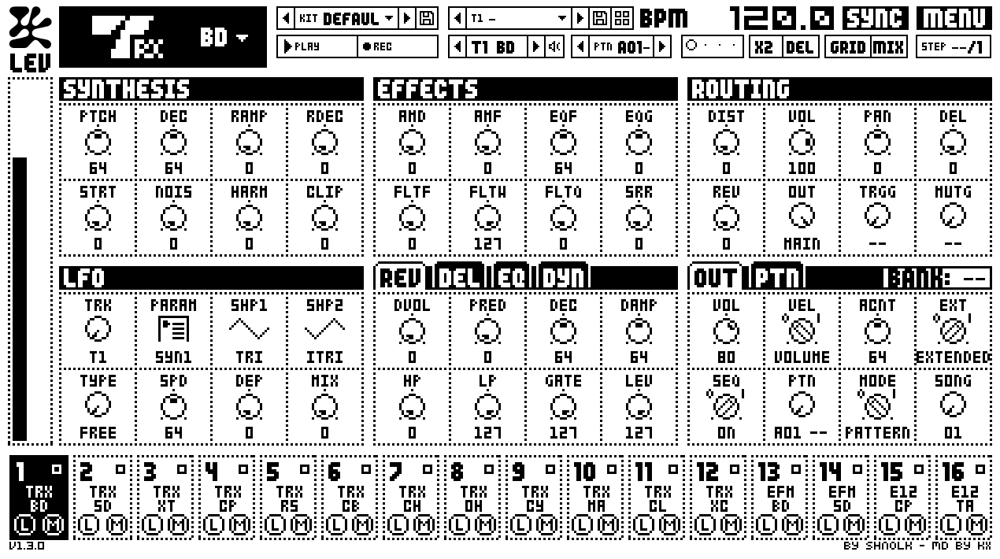
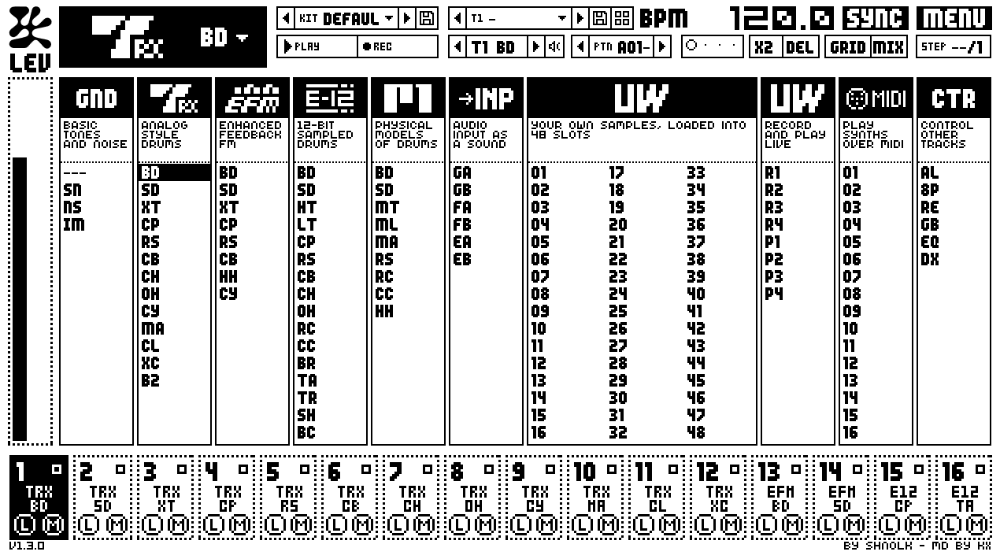
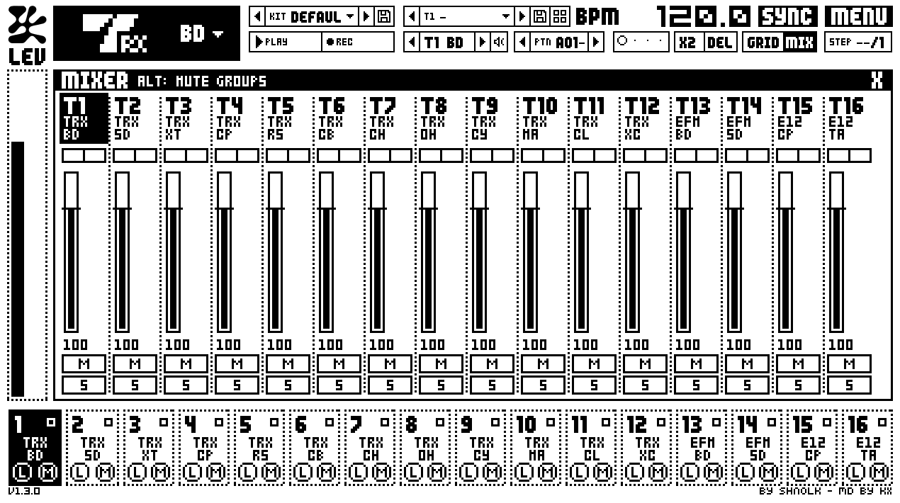
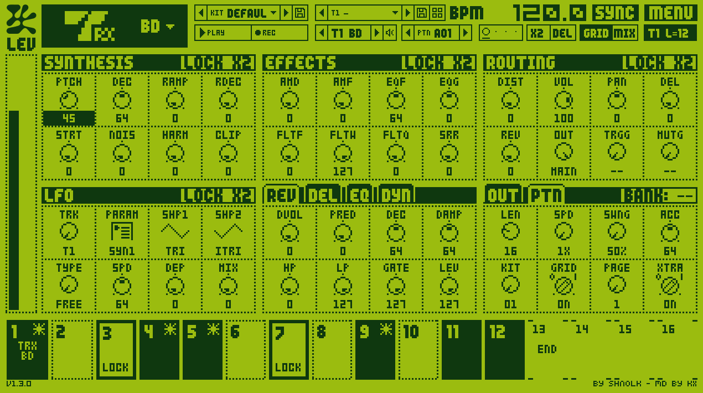
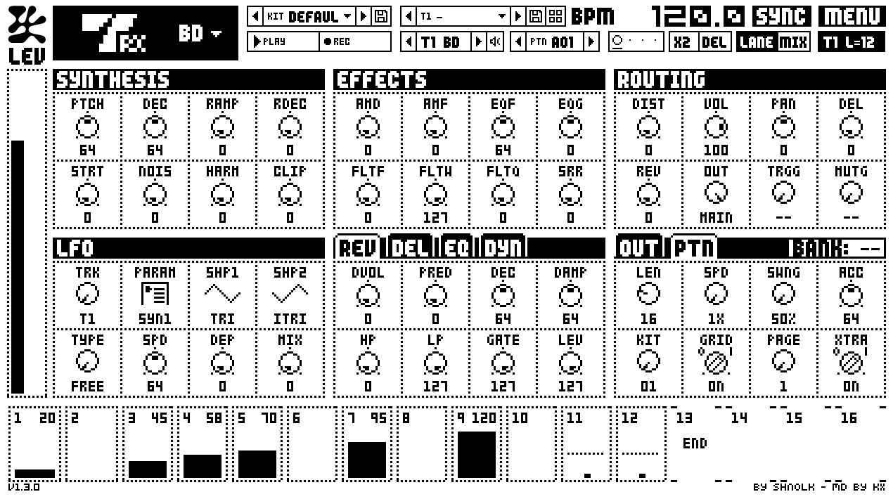
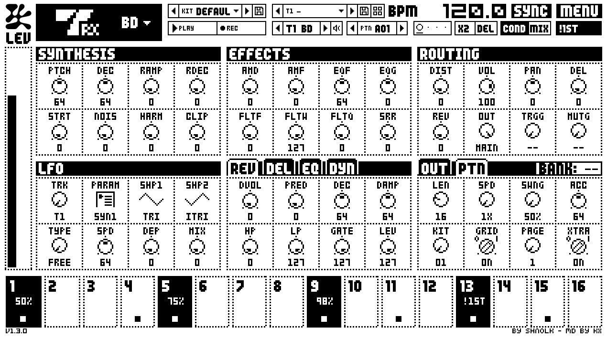
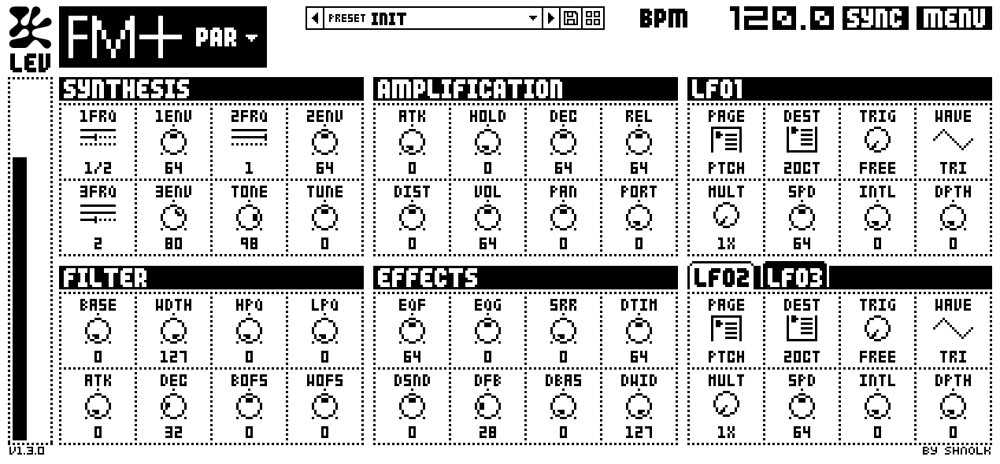
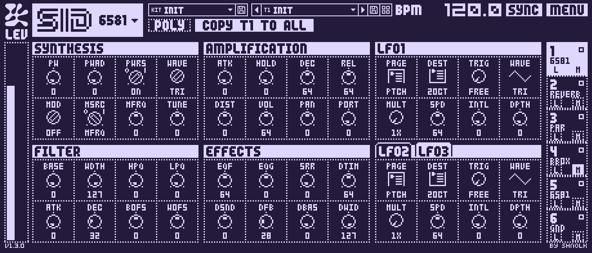

# ModuleDrum

**ModuleDrum** is a free, open-source, chip-level emulation of the Elektron Machinedrum (SPS-1 UW) as a plugin for
your DAW. It doesn't approximate the drum machine with new DSP code: it runs the Machinedrum's own operating system
and DSP programs inside emulated processors, so the sound is the hardware's. Around that it has the Machinedrum's
sequencer (patterns, parameter locks, songs), a library for kits and patterns, and a set of optional extras the
hardware never had.

ModuleDrum is a **fork of [Monomodule](https://github.com/shnolk/monomodule)** by Shnolk, which does the same for the
Elektron Monomachine. ModuleDrum is built on Monomodule's engine approach, its LCD interface and its library, and this
repository still builds the Monomodule plugins alongside it, with a few additions
(see [What's included](#whats-included)). Up to version 1.3.0 ModuleDrum was called "Monomodule MD".

> **ModuleDrum and Monomodule are not affiliated with, endorsed by or sponsored by Elektron.** "Elektron",
> "Machinedrum" and "Monomachine" are trademarks of Elektron Music Machines MAQ AB, used here only to describe what
> the plugins emulate. They contain no Elektron software. To make sound each needs its machine's OS file, which you
> download from Elektron yourself (see [Getting the OS files](#getting-the-os-files)).

## Screenshots

The colours are the plugins' own: **MENU > SKIN** has DEFAULT, INVERTED, LOW CONTRAST and CUSTOM (any ink and paper
colour). Each shot below uses a different one.



| | |
|---|---|
|  The machine picker (INVERTED) |  The mixer |
|  GRID: the keys are steps; two held for parameter locks, the track 12 steps long |  The lock lane: one parameter's locks across the page |
|  Trig conditions (with XTRA on) | |

**Listen:** [a footwork beat from ModuleDrum](docs/audio/md-footwork-demo.wav) (160 BPM, 36 seconds). Six patterns
chained one after the other: an intro, the beat, the bass coming in, a two-bar break, then two heavier ones. The default
kit's machines with parameter locks, retrig rolls and a 12-step tom loop against the 16. It is written in code and
rendered by the plugin: `src/plugin/md/test/MdDemo.cpp`.

The Monomodule plugins, from the same repository:

| | |
|---|---|
|  Monomodule One |  Monomodule Six |

## What's included

| | Type | What it does |
|---|---|---|
| **ModuleDrum** | Instrument (AU, VST3, standalone) | The Elektron Machinedrum (SPS-1 UW), run on its own OS and DSP code. All 16 tracks with every machine family (TRX, EFM, E12, P-I, GND, INP, RAM and ROM, plus the MID and CTR control machines), the master effects (delay, Gate Box reverb, EQ, dynamix), the sequencer with parameter locks, slides, chains and songs, optional separate outputs per track (16 stereo outputs), drag-and-drop samples onto ROM slots, MIDI clips in and out, and the Library panel for Machinedrum kits, patterns and songs. By KX. |

From Monomodule (Shnolk's work, built here as well):

| | Type | What it does |
|---|---|---|
| **Monomodule One** | Instrument (AU, VST3, standalone) | One Monomachine track. Plays all 22 machines: GND, SWAVE, SID, DPRO, FM+, VO-6 and the FX machines. The editor recreates the hardware's LCD pages, with the SYN, AMP, FILT and EFX pages plus three LFOs. FX machines process the side-chain input. |
| **Monomodule Six** | Instrument (AU, VST3, standalone) | All six tracks in one instance. MIDI channels 1-6 play tracks 1-6. It has six stereo outputs, and each track has its own routing: OUT BUS AB/CD/EF, and for FX machines an input of NEIBOR, INP A/B/AB or BUS AB/CD/EF. |
| **Monomodule FX** | Effect (AU, VST3) | The FX machines as an audio effect: THRU, REVERB, CHORUS, DYNAMIX, RINGMOD, PHASER and FLANGER. |
| **Monomodule Library** | Standalone app | A library for Monomachine and Machinedrum sysex dumps. It imports `.syx` files without losing any data, keeps a version history for each machine you own, and lets you browse presets, kits and patterns with audio previews. You can drag items into the plugins or your DAW. |

What this fork adds to the Monomodule plugins:

- **POLY** on Monomodule Six: chords on one MIDI channel, the notes spread over the six tracks.
- **COPY Tn TO ALL** on Six: one track's sound onto all six.
- **Up / Down** arrow keys step through presets and kits.
- Tooltips, and list knobs that step one value per wheel tick.
- Machinedrum projects, kits, sounds and patterns in the Library app.

For anything else about the Monomachine plugins, [Monomodule's own repository](https://github.com/shnolk/monomodule)
is the source.

Every parameter is a raw 0-127 value, just like on the hardware, so a track's settings are the same as a kit track
in a sysex dump. The plugins and the Library app share presets, kits and patterns.

## Getting the OS files

**ModuleDrum** needs the **Machinedrum UW OS 1.63**, which Elektron provides as a free download:

1. Download [Elektron_SPS1-1UW_OS1.63.zip](https://www.elektron.se/wp-content/uploads/2024/09/Elektron_SPS1-1UW_OS1.63.zip)
   from Elektron's website.
2. Unzip it. Inside is `Elektron_SPS1-1UW_OS1.63.syx`.
3. Open ModuleDrum, click **Select OS File...** and choose that `.syx` file.

You only have to do this once. The file stays where you put it: ModuleDrum reads it each time it starts and never
copies it or redistributes it.

**The Monomodule plugins** need **Monomachine OS 1.32B** in the same way:
[Elektron_SFX6-60_OS1.32B.zip](https://www.elektron.se/wp-content/uploads/2024/09/Elektron_SFX6-60_OS1.32B.zip), which
holds `Elektron_SFX6-60_OS1.32B.syx`. All of them and the Library app share the setting. With that file present
ModuleDrum also draws its LCD with the Monomachine's fonts and dials; without it, with a built-in stand-in font.

### Coming from "Monomodule MD"

ModuleDrum is the same plugin to a DAW as Monomodule MD was (the same plugin ID), so sets saved with it should open with
ModuleDrum. Remove the old one, or the host sees two plugins with one ID: delete `Monomodule MD.vst3` (and on macOS
`Monomodule MD.component` and `Monomodule MD.app`) from your plugin folders. The macOS installer does this for you.

## Using ModuleDrum

**Sounds.** Pick a machine with the logo block (top left); the four pages are the track's SYNTHESIS, EFFECTS, ROUTING
and LFO. The 16 keys at the bottom select tracks (L = keep the sound when a kit loads, M = mute). MIDI notes on the base
channel (default 1, notes C1-D3) play the tracks. Load kits from the **KIT** list or drop `.syx` files on the window.

**Sequencer.** The bar under the kit strip runs the Machinedrum's own sequencer (patterns of up to 64 steps, parameter
locks, slides, accents, swing, the four speeds, song mode). SEQ is on by default, so **Ableton's play runs the pattern**;
**PLAY** runs it on the plugin's own clock when Ableton is stopped. A kit loaded from a project brings that project's
patterns along.

| Do | How |
|---|---|
| Place steps | **GRID** (or the **G** key) on, then click the keys (drag across keys to paint steps on or off; the keys show the track, e.g. T3 SD) (they are the selected track's steps). **TRK < >** picks the track |
| Lock parameters on a step | **Shift+click** the step, turn knobs (they are that step's locks); double-click a knob to clear its lock; Shift+click again to release |
| Accent / slide / swing on a step | GRID: the **A / S / W** keys open the ACCENT / SLIDE / SWING edit window (the keys then show and flip that mark; drag across keys to paint it; the same key again, or Esc, goes back to the trigs). **Shift+A / S / W**: that mark for all tracks or the selected track |
| Step menu (accent, slide, swing, clear locks) | Right-click a step |
| Select / mute a track in GRID | **Ctrl+click** / **Alt+click** a key (key n = track n), or **M** on the bar |
| Pages (17-64) | The page dots: click to show a page (the playing page blinks on the beat). **DEL** removes the shown page |
| Select a track without hearing it | **Ctrl+click** its key (a plain click plays it, as on the MD) |
| Speeds | 1X 2X 3/4X 3/2X as on the MD, plus the plugin's own 1/2X 1/4X 1/8X 3X (PTN tab, SPD) |
| Reverse a ROM / RAM-P sample | Set END lower than STRT (as on the MD) |
| Copy / paste / clear | **Shift / Ctrl / Alt + click** on a page dot (that page), **TRK** (the track) or **PTN** (the pattern). Keys: Ctrl+C / Ctrl+V / Delete on the shown page |
| Double the pattern | **X2** or Ctrl+D |
| Move a track's trigs one step | GRID on: **Shift+Left / Right** (plain Left / Right: previous / next page) |
| Copy / paste one note with its locks | Hold a step (Shift+click), then **Ctrl+C**, hold another, **Ctrl+V**. **Delete** clears a held step's locks |
| Lock a knob's value as it is | Hold a step and **click** the knob (no turn needed) |
| Chain patterns | **Shift+click PTN >** adds the next pattern to a looping chain (CHN A01>A02...), **Shift+click <** takes the last off; picking a pattern ends it |
| Change a parameter on every track | **Alt+turn** the knob (not MID, RAM-R or CTR tracks) |
| Mute several tracks at once | **Shift+click** their M buttons, then let go of Shift |
| Kit undo / reload | **Ctrl+Alt+Z** brings back the kit you replaced; **Ctrl+R** reloads the saved kit (also in MENU) |
| Copy / paste / clear a machine | **Ctrl+Shift+C / V / Delete** on the selected track (also in MENU) |
| Undo / redo | Ctrl+Z / Ctrl+Shift+Z (also in MENU) |
| Live recording | **REC**, then play: notes and track keys go onto the nearest step, knob turns become locks |
| Length, speed, swing, accent, kit | The OUTPUT panel's **PATTERN** tab |
| Songs | MODE = SONG on the OUT tab; MENU > EDIT SONG to edit its rows. In the editor (as the MD): **Up / Down** pick a row, **Enter** starts there (or, while playing, plays it next), **Ctrl+Down / Up** insert / delete a row, **Ctrl+C / V** copy / paste a row. A LOOP to a later row is a JUMP, to its own row a HALT |
| Patterns as Ableton MIDI clips | **Drag the PTN box** (the whole pattern) or **the track box** (T1 BD: that track) onto an Ableton track: a clip of its trigs (accents as velocity, locks as CCs) |
| MIDI clips into patterns | **Drop a .mid clip** (from Ableton) on the plugin: its notes go onto the tracks by the note map (velocity 112+ = accent, the CC map's controllers = locks); dropped **on a track key**, every note goes onto that track |
| Resample a track | MENU > SAMPLES, pick a slot, **RESAMPLE Tn**: the selected track's sound rendered into it |
| Learn a note map entry | MIDI SETTINGS: **click** a note cell (a track, FROM, START, STOP), then play the note. Click again or Esc: cancel |
| Samples | MENU > SAMPLES: the 48 ROM slots. Rename (Enter / double-click), clear (Delete), **RAM 1-4 >** copies a RAM machine's recording into the selected slot (the RAM machines start empty after, as on the MD) |
| CLASSIC / EXTENDED | OUT tab, **EXT**: CLASSIC plays patterns without their locks (kept) and without their kits, as the MD's CLASSIC mode |
| Hold several steps | GRID: **Shift+click** holds one step, **Ctrl+Shift+click** adds or removes another, **Shift+drag** holds a run; **Esc** lets go. A knob turn locks every held step; a click on a held step in an edit window (A / S / W, C / T / R) acts on all of them; Delete clears their locks |
| Copy / cut / paste / duplicate notes | With steps held: **Ctrl+C**, **Ctrl+X**, **Ctrl+V** (pasted from the held step on, spaced as they were), **Ctrl+D** (the figure again right after itself, then that copy held: press it again to walk along the page) |
| Generate a track's trigs | GRID: **E** opens GENERATE. **Click key N**: N hits a page spread evenly. **Shift+click**: N at random (again: another roll). **Alt+click**: every Nth step. **Wheel**: rotate. Steps that were there keep their locks; the whole run is one undo step |
| Lock lane | GRID: **L** shows one parameter's locks across the page as bars (the knob you touched last). **Drag** to draw, **Shift+drag** a ramp, **Alt+click** clears, **wheel** nudges (Shift: by 8). Opening it shows the lock rows used (of 64) |
| Clear one layer | **Delete** in an edit window clears only what that window edits on the page (accents, conditions, the lane's locks...) |
| Mutate a sound | **U**: the selected track's SYNTHESIS knobs move a fifth of the way to random values (**Shift+U**: EFFECTS too). Again: another roll from the same start. **Ctrl+Alt+Z** brings the sound back |
| Humanise, a track's own length (with XTRA on) | TIME window: **H** nudges the track's trigs at random (**Shift+H**: more), Delete clears. **Ctrl+Alt+click** a step: the track loops there, against the pattern (again: off) |
| Extras: trig conditions, micro-timing, retrigs | Not on a real MD; off until PTN tab **XTRA** is on. Then in GRID, **C / T / R** open the CONDITION / TIME / RETRIG windows. **Click** a trig to give it the last value (click again: clear; drag to paint). **Wheel** over it changes the value (RETRIG: Shift+wheel sets its length). Conditions: 1-99%, FILL / !FILL, PRE / !PRE, NEI / !NEI, 1ST / !1ST, A:B. Hold **F** for fill, **Shift+F** latches it. Extras are saved with the set and in the Library; .syx exports leave them out |
| Use the MD as a sound module | MIDI SETTINGS > **CTRL IN OFF**: Ableton's play / stop don't run the sequencer (PLAY does, at Ableton's tempo; LFOs and delay stay in time) |
| Keep your edits | Saved with the Ableton set; MENU > SAVE PATTERNS + SONGS TO LIBRARY puts them in the Library project |
| MIDI channel, note map, program change, MIDI out | MENU > MIDI SETTINGS |
| Play patterns from MIDI notes | MENU > MIDI SETTINGS > PATTERN NOTES: FROM a white key (16 patterns of a bank up the white keys), START / STOP notes; GATE (plays while held), MOMENTARY (the pattern before comes back), QUEUE (next pattern). FROM PROJECT brings in a project's own map |
| Mixer (all 16 levels, pans, mutes, solos, mute groups) | **MIX** on the bar or the **M** key; Shift+click M / S = only that track; hold **Alt** to see the mute groups on the M buttons, **Alt+click** M for the next group (Alt+Shift+click: back) |
| Browse kits / sounds | Click the KIT or sound selector, then **Up / Down** (on One / Six: presets, or kits after the KIT selector) |

## Installing on macOS

Download the latest release from **[Releases](https://github.com/K-X420/ModuleDrum/releases)**. The macOS zip
(`ModuleDrum-<version>-macos-universal.zip`; `Monomodule-...` up to 1.3.0) runs on Apple Silicon and Intel Macs, macOS 12 or later.

1. Unzip it.
2. Double-click **Install ModuleDrum.command** (**Install Monomodule.command** up to 1.3.0). If macOS says it can't be opened because it is from an
   unidentified developer, open **System Settings > Privacy & Security**, scroll down and click **Open Anyway**
   (or right-click the file and choose **Open**). Or run it from Terminal: `bash ~/Downloads/ModuleDrum-*/Install\ ModuleDrum.command`.
3. It copies the VST3 and AU plugins to `~/Library/Audio/Plug-Ins/`, and the standalone apps and the Library app
   to `~/Applications`. These builds aren't notarised by Apple, so the script also clears the download quarantine
   flag and signs each bundle locally. Without that, hosts refuse to load them.
4. Restart your DAW and rescan plugins. In Ableton Live, turn on **Use Audio Units v2** and/or **Use VST3 Plug-in
   System Folders** under **Settings > Plug-ins**, then click **Rescan**.

## Installing a release

Pre-built zips for macOS, Windows and Linux are on the **[Releases](https://github.com/K-X420/ModuleDrum/releases)** page.
Each zip has a `VST3` folder (ModuleDrum plus the Monomodule One, Six and FX plugins), a `Standalone` folder, a
`Library` folder with the Library app, and on macOS an `AU` folder and the installer described above. There is no
Windows or Linux installer; copy the files yourself:

| Platform | Plugins | Library app |
|---|---|---|
| macOS 12+ (Apple Silicon and Intel) | Run **Install ModuleDrum.command** (see above). | Installed to `~/Applications` by the same script. |
| Windows 10+ (x64) | Copy the `.vst3` folders from `VST3` to `C:\Program Files\Common Files\VST3\`. | Copy the contents of `Library` to `%LOCALAPPDATA%\Programs\Shnolk\Monomodule\` (or `C:\Program Files\Shnolk\Monomodule\`). |
| Linux (x64) | Copy the `.vst3` folders from `VST3` to `~/.vst3/`. | Copy `Monomodule Library` to `~/.local/bin/`. |

The plugin's library panel opens the Library app from these locations. The plugins work without it.

## Building from source

### Requirements

- CMake 3.22 or newer, Git, and a C++17 compiler
- An internet connection for the first configure. CMake downloads [JUCE](https://github.com/juce-framework/JUCE)
  8.0.9 and [dsp56300](https://github.com/dsp56300/dsp56300), pinned to a fixed commit, and applies
  `ext/patches/0001-dsp56300-mnm.patch` to it.

### macOS

Needs Xcode or the Xcode command line tools (`xcode-select --install`). [Ninja](https://ninja-build.org) is optional
but faster.

```bash
cmake -S . -B build -G Ninja -DCMAKE_BUILD_TYPE=Release
cmake --build build
```

The build copies the AU and VST3 plugins to `~/Library/Audio/Plug-Ins/`. For a universal (Apple Silicon and
Intel) build, add `-DCMAKE_OSX_ARCHITECTURES="arm64;x86_64"` to the first command.

### Linux

On Debian or Ubuntu:

```bash
sudo apt install build-essential cmake git ninja-build pkg-config \
  libasound2-dev libjack-jackd2-dev libfreetype-dev libfontconfig1-dev \
  libx11-dev libxcomposite-dev libxcursor-dev libxext-dev libxinerama-dev libxrandr-dev libxrender-dev \
  libgl1-mesa-dev libcurl4-openssl-dev libgtk-3-dev libwebkit2gtk-4.1-dev
cmake -S . -B build -G Ninja -DCMAKE_BUILD_TYPE=Release
cmake --build build
```

The emulator keeps its memory in `/dev/shm`. On a normal desktop that folder is large enough, but a Docker container gets
only 64 MB by default, which crashes the engine. In a container, start it with `--shm-size=1g` or more.

The build copies the VST3 plugins to `~/.vst3/`. The standalone versions of One and Six and the Library app are in
`build/src/plugin/*_artefacts/Release/Standalone/` and `build/src/app/MnmLibraryApp_artefacts/Release/`.

### Windows

Needs Visual Studio 2022 with the **Desktop development with C++** workload. Run these in a *Developer PowerShell for VS
2022*:

```powershell
cmake -S . -B build -G "Visual Studio 17 2022" -A x64
cmake --build build --config Release
```

The VST3 plugins are in `build\src\plugin\*_artefacts\Release\VST3\`. Copy them to
`C:\Program Files\Common Files\VST3\`, or configure with `-DMNM_COPY_PLUGINS=ON` from an administrator prompt so the
build copies them for you.

### Build options

| Option | Default | Meaning |
|---|---|---|
| `MNM_BUILD_PLUGIN` | `ON` | Build the plugins and the Library app. `OFF` builds only the engine, the tests and `mnm-render`. |
| `MNM_BUILD_TESTS` | `ON` | Build the unit tests. |
| `MNM_COPY_PLUGINS` | `ON` (`OFF` on Windows) | Copy the plugins to the plugin folders after each build. |
| `MNM_OS_SYX` | *(empty)* | Path to your OS file. Used by the tests and the command-line tools. |
| `MNM_DSP56300_DIR` | *(empty)* | Use an existing, already patched dsp56300 checkout instead of downloading one. |

### Tests

```bash
cmake -S . -B build -DMNM_OS_SYX=/path/to/Elektron_SFX6-60_OS1.32B.syx
cmake --build build --target mnm-tests
ctest --test-dir build --output-on-failure
```

The tests that run the emulated DSP need the OS file. You can pass it through `MNM_OS_SYX` as above, or through the
`MNM_OS` environment variable. Without it, those tests are reported as skipped and the rest still run.

ModuleDrum has its own headless checks (sequencer, GRID edits, MIDI, the MID / CTR machines, samples and
more). Build the `MnmMdTest` target, then run them all with the MD OS file. `--kits` takes any MD kit dump and is only
needed for the kit / sound selector check:

```bash
cmake --build build --target MnmMdTest
python tests/run_md_tests.py --md-os /path/to/Elektron_SPS1-1UW_OS1.63.syx --kits /path/to/kits.syx
```

They write to a temporary library folder, never your own.

### Command-line tools

- `mnm-render` plays one note on one machine and writes a WAV file, e.g.
  `mnm-render --fw OS.syx --machine "FM+ PAR" --note 69 --dur 1 --out a4.wav`. Run it without arguments to see every
  option.
- `mnm-libtool` is the Library from the terminal: `import`, `list`, `show`, `export`, `verify` (a byte-for-byte
  round trip of a dump), `preview` (renders an audio preview to a WAV file) and more.

## How it works

- **OS file.** `src/core/firmware` unpacks the user's OS file: the sysex transport, the flash container and the
  compressed sections. From these it takes the DSP program and data.
- **DSP.** `src/core/dsp` loads that program into the dsp56300 emulator. Its JIT compiles the DSP code to native
  code. A small harness replaces the hardware's audio I/O: every 16 samples it sends in a 52-word parameter block
  for one track and reads out 16 stereo frames.
- **Host model.** On the hardware, the main processor builds those parameter blocks. `src/core/host` does the same
  job: note and trigger handling, tempo, parameter smoothing and the three LFOs of each track.
- **Plugins.** `src/plugin` holds the plugins. One, Six and FX share one processor and one editor. The editor draws
  the LCD with the fonts and icons from your OS file. Without an OS file it falls back to a built-in stand-in font.
- **Library.** `src/core/library` and `src/library` hold the sysex codec, the catalogue that merges identical items
  across dumps, the project and version store, and offline preview rendering. The app is in `src/app`.

## Known limitations

ModuleDrum:

- MIDI transfer to and from a real Machinedrum (sysex send / receive, clock out) isn't implemented yet. To move
  dumps, use `.syx` files with Elektron's C6 or Transfer tools.
- The extras (trig conditions, micro-timing, retrigs, a track's own length) are the plugin's own: a real Machinedrum
  has no room for them, so `.syx` exports leave them out. Library previews and MIDI clip export also play the
  plain pattern, without them.
- From a global, ModuleDrum uses the MIDI settings (key map, channel, sync, program change, pattern notes). The
  EXTENDED MODE, LOCAL and audio-input trigger settings are kept in the project but not applied.
- It has not yet been compared side by side with the hardware.

The Monomodule plugins:

- DPRO-DDRW and DPRO-DENS read the Digibank waveforms, which live in the Monomachine's +Drive memory and are not
  part of the OS file. Monomodule builds a stand-in bank instead: the 32 DPRO-WAVE waveforms plus 32 classic
  single-cycle shapes.
- The delay time of the EFX page does not yet follow DTIM and the tempo the way the hardware does.
- A machine change triggers the machine once, as on the hardware. Because of this, a new instance plays a short
  blip right after the OS loads.
- MIDI transfer to and from the hardware isn't implemented yet. To move dumps, use `.syx` files with Elektron's C6
  or Transfer tools.

## Settings and data

ModuleDrum and Monomodule keep their settings and their shared library in the user application-data folder:

- macOS: `~/Library/Application Support/Shnolk/Monomachine/`
- Windows: `%APPDATA%\Shnolk\Monomachine\`
- Linux: `~/.config/Shnolk/Monomachine/`

## Licence

ModuleDrum, like Monomodule, is free software: you can redistribute it and/or modify it under the terms of the
**GNU Affero General Public License v3.0** (see [LICENSE](LICENSE)). Anyone who distributes it, modified or
not, must pass on these same rights and make the corresponding source code available.

It is built on [JUCE](https://github.com/juce-framework/JUCE) (AGPLv3) and
[dsp56300](https://github.com/dsp56300/dsp56300) (GPLv3), among others.
[THIRD_PARTY_NOTICES.md](THIRD_PARTY_NOTICES.md) lists every dependency, its licence and the changes made to
dsp56300.

## Credits

**ModuleDrum** (the Machinedrum plugin, its library support and the additions listed above) is by **KX**.

**[Monomodule](https://github.com/shnolk/monomodule)**, which ModuleDrum is forked from and built on (the
Monomachine plugins, the LCD interface, the Library app, the emulation approach), is made by **Shnolk**. Contact:
[@shnolk](https://www.instagram.com/shnolk) on Instagram, or [shnolk@halftone.world](mailto:shnolk@halftone.world).

Both stand on the work of:

- [dsp56300](https://github.com/dsp56300/dsp56300), the DSP56300 emulator at the heart of the sound engine
- [JUCE](https://github.com/juce-framework/JUCE), the plugin and UI framework
- [AsmJit](https://github.com/asmjit/asmjit), the JIT back end of dsp56300
- [MCL](https://github.com/jmamma/MCL), whose documentation of the Monomachine sysex formats guided the Library's codec
- [elektron-firmware-tool](https://github.com/mischa85/elektron-firmware-tool), for its work on the Elektron OS file
  format

Bug reports and pull requests are welcome.
